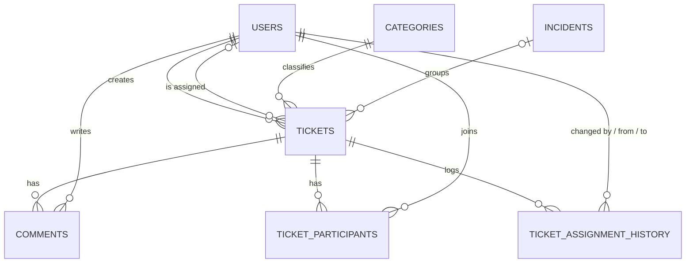

# Smart Helpdesk

Accountable support ticketing for campuses. Every ticket has an owner, a reason and an ending.

**Live demo:** https://smarthelpdesk-jet.vercel.app
(The backend runs on a free tier, so the first load can take about 30 seconds.)


## About
Complaints on a campus arrive through scattered channels, get reported again and again, and nobody knows who owns them. Smart Helpdesk fixes this: students raise tickets, an admin assigns one owner agent, the agent resolves it, and the admin closes it with a written note.

Built solo by **Monish Iyyappan**.

## Features
- **Role-based access:** Student, Agent and Admin, with roles checked on the server
- **Single owner:** one agent per ticket
- **Reasoned handover:** every reassignment needs a written reason (10-500 characters)
- **Closure notes and reopen:** closing needs a note, and an admin can reopen a resolved ticket with a reason
- **Live urgency:** LOW, MEDIUM, HIGH or URGENT, calculated on every read and never typed by the user
- **Overdue alerts:** tickets past their SLA deadline turn red and escalate a level
- **Shared incidents:** many tickets link to one incident, with ticket counts per incident
- **Join a ticket:** students join an existing ticket instead of filing a duplicate
- **Audit trail:** assignment history, typed comments and a closed-ticket log

## Ticket lifecycle
`OPEN` → `ASSIGNED` → `IN_PROGRESS` → `RESOLVED` → `CLOSED`
(an admin can reopen a `RESOLVED` ticket back to `IN_PROGRESS`)

## Screenshots
| Student dashboard | Agent dashboard |
|---|---|
|  |  |


| Admin dashboard | Incidents |
|---|---|
|  |  |

| Tickets Details | Ticket History |
|---|---|
|  |  |

## Tech stack
| Layer | Technology | Hosting |
|---|---|---|
| Frontend | React, Vite, TypeScript, Tailwind | Vercel |
| Backend | Java 17, Spring Boot 3.4, Spring JDBC | Render (Docker) |
| Database | MySQL 8 (7 tables) | Aiven |
| Security | HTTP Basic login, BCrypt password hashing | |
| Tests | JUnit 5 (108 backend tests) | |

## Architecture
```text
React app  →  REST API (controller → service → dao)  →  MySQL
```
Backend packages: `controller`, `service`, `dao`, `model`, `assignment`, `priority`, `config`, `exception`.

## Database


## How to run locally
**Prerequisites:** Java 17, Maven, Node.js (YOUR_NODE_VERSION) and MySQL 8.

**1. Clone**
```bash
git clone https://github.com/Monish-Iyyappan/smarthelpdesk.git
cd smarthelpdesk
```

**2. Create the database**
```bash
mysql -u root -p -e "CREATE DATABASE smart_helpdesk"
mysql -u root -p smart_helpdesk < database/schema.sql
mysql -u root -p smart_helpdesk < database/migration_assignment.sql
mysql -u root -p smart_helpdesk < database/migration_reopen.sql
mysql -u root -p smart_helpdesk < database/seed_data.sql
```
Check that the order matches your repo. If `schema.sql` already includes the migrations, skip those two lines.

**3. Run the backend** (http://localhost:8080)
```bash
cd YOUR_BACKEND_FOLDER
# set the DB username and password as environment variables
mvn spring-boot:run
```

**4. Run the frontend** (http://localhost:3000)
```bash
cd YOUR_FRONTEND_FOLDER
npm install
npm run dev
```

**5. Run the tests**
```bash
mvn test
```

## Demo accounts
| Role | Email | Password |
|---|---|---|
| Admin | admin@college.example | Test@1234 |
| Agent | agent1@college.example | Test@1234 |
| Student | student1@college.example | Test@1234 |

These are demo accounts with sample data only. Do not reuse this password anywhere real.

## Roadmap
Email or SMS alerts, login rate limiting and lockout, SLA and reassignment reports, sub-categories, agent routing by skill, a mobile app (PWA), AI auto-categorization.

## Author
**Monish Iyyappan** · [GitHub](https://github.com/Monish-Iyyappan)
