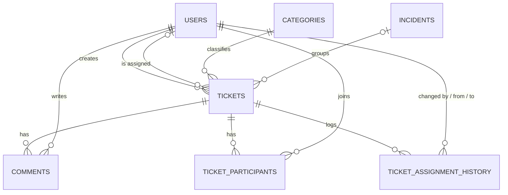

# Smart Helpdesk

Accountable support ticketing for campuses. Every ticket has an owner, a reason and an ending.

**Live demo:** https://smarthelpdesk-jet.vercel.app
(The backend runs on a free tier, so the first load can take about 30 seconds.)


## About
Complaints on a campus arrive through scattered channels, get reported again and again, and nobody knows who owns them. Smart Helpdesk fixes this: students raise tickets, an admin assigns one owner agent, the agent resolves it, and the admin closes it with a written note.

Built solo by **Monish Iyyappan**.

## Features
- **Role-based access:** Student, Agent and Admin, with roles checked on the server
- **Single owner:** one agent per ticket
- **Reasoned handover:** every reassignment needs a written reason (10-500 characters)
- **Closure notes and reopen:** closing needs a note, and an admin can reopen a resolved ticket with a reason
- **Live urgency:** LOW, MEDIUM, HIGH or URGENT, calculated on every read and never typed by the user
- **Overdue alerts:** tickets past their SLA deadline turn red and escalate a level
- **Shared incidents:** many tickets link to one incident, with ticket counts per incident
- **Join a ticket:** students join an existing ticket instead of filing a duplicate
- **Audit trail:** assignment history, typed comments and a closed-ticket log
- **Interactive Terminal UI:** built-in CLI client with ANSI colors demonstrating pure Java OOP abstraction (`BaseScreen`)

## Ticket lifecycle
`OPEN` → `ASSIGNED` → `IN_PROGRESS` → `RESOLVED` → `CLOSED`
(an admin can reopen a `RESOLVED` ticket back to `IN_PROGRESS`)

## Screenshots
| Student dashboard | Agent dashboard |
|---|---|
|  |  |


| Admin dashboard | Incidents |
|---|---|
|  |  |

| Tickets Details | Ticket History |
|---|---|
|  |  |

## Tech stack
| Layer | Technology | Hosting |
|---|---|---|
| Frontend | React, Vite, TypeScript, Tailwind | Vercel |
| Backend | Java 17, Spring Boot 3.4, Spring JDBC | Render (Docker) |
| Database | MySQL 8 (7 tables) | Aiven |
| Security | HTTP Basic login, BCrypt password hashing | |
| Tests | JUnit 5 (108 backend tests) | |

## Architecture
```text
React app  →  REST API (controller → service → dao)  →  MySQL
Terminal   →  REST API (controller → service → dao)  →  MySQL
```
Backend packages: `controller`, `service`, `dao`, `model`, `assignment`, `priority`, `config`, `exception`, `terminal`.

## Database (7 Tables)


## How to run locally

### Prerequisites
- **Java 17** (LTS)
- **Maven 3.8+**
- **Node.js 18+** & npm
- **MySQL 8** (running locally on port 3306)

---

### Step 1: Clone the repository
```bash
git clone https://github.com/Monish-Iyyappan/smarthelpdesk.git
cd smarthelpdesk
```

---

### Step 2: Initialize the MySQL database
Run the unified schema and seed script:
```powershell
mysql -u root -p -e "CREATE DATABASE IF NOT EXISTS smart_helpdesk;"
mysql -u root -p smart_helpdesk < database/seed_schema.sql
```
*(This sets up all 7 tables and default seed data idempotently).*

---

### Step 3: Run the Backend (Spring Boot on http://localhost:8080)
Open a terminal in the project root directory and set your environment variables:

```powershell
# Set database environment variables for this terminal session:
$env:DB_URL = "jdbc:mysql://localhost:3306/smart_helpdesk"
$env:DB_USERNAME = "root"
$env:DB_PASSWORD = "YOUR_MYSQL_PASSWORD"

# Launch Spring Boot:
mvn spring-boot:run
```
Upon startup, the server boots and asks:
```text
Run terminal UI? (y/N)
```
- Type `y` to explore the interactive ANSI terminal interface.
- Type `n` to let the backend run as a pure REST API for the React frontend.

---

### Step 4: Run the Frontend (React on http://localhost:3000)
Open a second terminal window:

```bash
cd frontend
npm install
npm run dev
```
Open your browser at `http://localhost:3000`.

---

### Step 5: Run Automated Tests
```powershell
# Run the complete test suite:
mvn test

# Run individual unit tests:
mvn test -Dtest=UrgencyCalculatorTest
mvn test -Dtest=AssignmentPolicyTest
```

---

## Demo accounts
| Role | Email | Password |
|---|---|---|
| Admin | admin@college.example | Test@1234 |
| Agent | agent1@college.example | Test@1234 |
| Student | student1@college.example | Test@1234 |

These are demo accounts with sample data only. Do not reuse this password anywhere real.

## Roadmap
Email or SMS alerts, login rate limiting and lockout, SLA and reassignment reports, sub-categories, agent routing by skill, a mobile app (PWA), AI auto-categorization.

## Author
**Monish Iyyappan** · [GitHub](https://github.com/Monish-Iyyappan)
