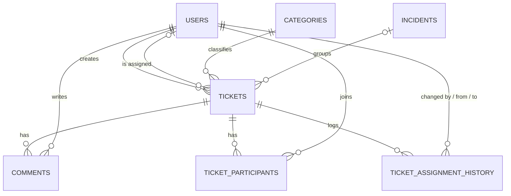

# Smart Helpdesk — Database Management Guide

## 1. Project Overview

Smart Helpdesk is a College Support Ticketing System built using Java 17, Spring Boot, Maven, and MySQL.

The database stores users, support tickets, issue categories, shared incidents, ticket participants, comments, and assignment audit logs.

- **Database name:** `smart_helpdesk`
- **Storage engine:** InnoDB
- **Character set:** `utf8mb4`
- **Collation:** `utf8mb4_unicode_ci`

---

## 2. Database Tables and Why They Exist

### 2.1 `users`
**Purpose:** Stores all authenticated accounts (Students, Support Agents, and Admins).

**Columns:**
- `user_id`: Auto-increment primary key.
- `name`: Full display name.
- `email`: Unique email address used for login.
- `password_hash`: BCrypt hashed password (never stored in plain text).
- `role`: ENUM ('STUDENT', 'AGENT', 'ADMIN').
- `created_at`: Account creation timestamp.

---

### 2.2 `categories`
**Purpose:** Classifies tickets by department or service area.

**Columns:**
- `category_id`: Primary key.
- `category_name`: Name of the department.

**Default categories:**
1. IT Support
2. Examination
3. Student Administration
4. Fees and Payments
5. Transport
6. Timetable
7. Campus Facilities
8. Other

---

### 2.3 `tickets`
**Purpose:** The central entity storing individual complaint records.

**Columns:**
- `ticket_id`: Internal auto-increment primary key.
- `ticket_number`: Unique readable identifier (e.g. `HD-1001`).
- `created_by`: Foreign key to `users(user_id)`.
- `assigned_to`: Foreign key to `users(user_id)` (NULL until assigned).
- `category_id`: Foreign key to `categories(category_id)`.
- `incident_id`: Optional foreign key to `incidents(incident_id)`.
- `title` & `description`: Problem details.
- `priority`: ENUM ('LOW', 'MEDIUM', 'HIGH', 'URGENT').
- `status`: ENUM ('OPEN', 'ASSIGNED', 'IN_PROGRESS', 'RESOLVED', 'CLOSED').
- `created_at` & `updated_at`: Audit timestamps.

---

### 2.4 `ticket_participants`
**Purpose:** Junction table tracking students who experience or follow an existing ticket.

**Columns:**
- `participant_id`: Primary key.
- `ticket_id`: Foreign key to `tickets(ticket_id)`.
- `user_id`: Foreign key to `users(user_id)`.
- `joined_at`: Timestamp of joining.
- **Unique Constraint:** `(ticket_id, user_id)` prevents duplicate participation.

---

### 2.5 `incidents`
**Purpose:** Represents campus-wide outages (e.g., "Library Wi-Fi Down") grouping multiple individual tickets.

**Columns:**
- `incident_id`: Primary key.
- `title` & `description`: Summary of the outage.
- `location`: Affected campus building or area.
- `status`: ENUM ('OPEN', 'INVESTIGATING', 'RESOLVED').
- `severity`: ENUM ('LOW', 'MEDIUM', 'HIGH', 'CRITICAL').
- `created_at` & `updated_at`: Timestamps.

---

### 2.6 `comments`
**Purpose:** Chronological conversation feed, internal agent notes, and formal closure summaries.

**Columns:**
- `comment_id`: Primary key.
- `ticket_id`: Foreign key to `tickets(ticket_id)`.
- `user_id`: Foreign key to `users(user_id)`.
- `comment_text`: Message body.
- `comment_type`: ENUM ('GENERAL', 'ISSUE', 'REASSIGNMENT', 'CLOSURE', 'REOPEN').
- `created_at`: Timestamp.

---

### 2.7 `ticket_assignment_history`
**Purpose:** Immutable audit log tracking every agent handover and reassignment.

**Columns:**
- `history_id`: Primary key.
- `ticket_id`: Foreign key to `tickets(ticket_id)`.
- `from_agent`: Previous agent user ID (NULL on initial assignment).
- `to_agent`: New agent user ID.
- `changed_by`: Administrator user ID who authorized the assignment.
- `reason`: Mandatory 10–500 character explanation for reassignments.
- `changed_at`: Timestamp.

---

## 3. Relationships Between Tables



---

## 4. Initializing the Database

### Option A: MySQL Command Line (PowerShell)
From the project root:
```powershell
mysql -u root -p -e "CREATE DATABASE IF NOT EXISTS smart_helpdesk;"
mysql -u root -p smart_helpdesk < database/seed_schema.sql
```
*(Enter your password when prompted. This creates all 7 tables and loads sample seed data).*

### Option B: MySQL Workbench
1. Connect to your local MySQL instance.
2. Open `database/seed_schema.sql`.
3. Click the lightning bolt icon (Execute).

---

## 5. Verifying the Database

Run this query in MySQL:
```sql
USE smart_helpdesk;
SHOW TABLES;
```

**Expected 7 tables:**
1. `categories`
2. `comments`
3. `incidents`
4. `ticket_assignment_history`
5. `ticket_participants`
6. `tickets`
7. `users`

---

## 6. Backing Up the Database

To create a backup before making major changes:
```powershell
mysqldump -u root -p --single-transaction --routines --triggers --events smart_helpdesk > "database/smart_helpdesk_backup.sql"
```

## 7. Restoring a Backup
```powershell
mysql -u root -p smart_helpdesk < "database/smart_helpdesk_backup.sql"
```
