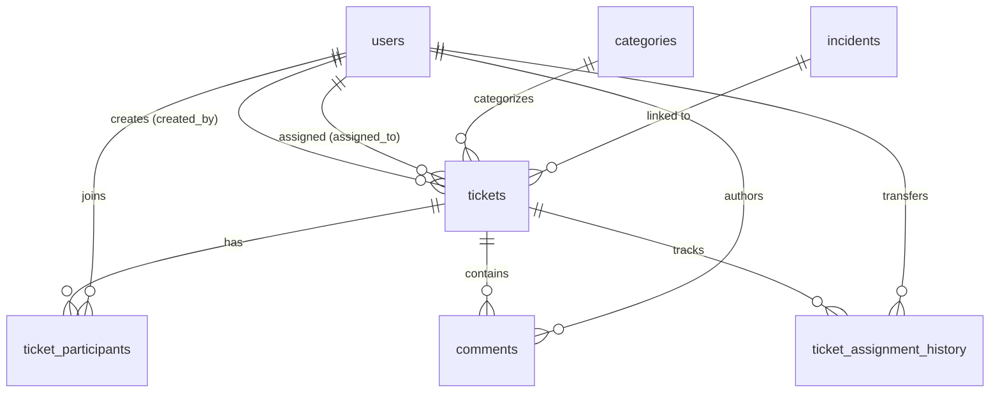

# Smart Helpdesk System - Technical Facts & Architecture Report

This report documents **only what actually exists** in the Smart Helpdesk codebase. It contains verified facts extracted directly from source code, database scripts, build configuration, and endpoint definitions. No unimplemented features are claimed as functional; items not built are explicitly designated as **not implemented**.

---

## 1. Tech Stack and Versions

| Component | Technology | Version | Location / Evidence |
| :--- | :--- | :--- | :--- |
| **Language** | Java | 17 (LTS) | `pom.xml` (`<java.version>17</java.version>`) |
| **Framework** | Spring Boot | 3.4.3 | `pom.xml` (`spring-boot-starter-parent` `3.4.3`) |
| **Spring Modules** | Spring Web, Spring JDBC, Spring Security, Spring Test | 3.4.3 | `pom.xml` dependencies |
| **Database** | MySQL | 8.x / compatible | `database/schema.sql`, `pom.xml` (`com.mysql:mysql-connector-j` runtime) |
| **Connection Pool** | HikariCP | 5.1.0 (managed by Spring Boot 3.4.3) | Default connection pool in `spring-boot-starter-jdbc` |
| **Build Tool** | Apache Maven | Wrapper (`mvnw`, `mvn.cmd`) / POM 4.0.0 | `pom.xml`, `mvnw`, `.mvn/wrapper/` |
| **Terminal Client** | Standard Java (Console I/O + `HttpClient`) | Java 17 | `src/main/java/com/smarthelpdesk/terminal/` |
| **Web Frontend** | React, TypeScript, Vite, Tailwind CSS | React 19.2.8, Vite 8.3.0, TS 6.0.2 | `frontend/package.json` |

---

## 2. Package & Class Inventory and OOP Concepts

The backend application source code is structured under `src/main/java/com/smarthelpdesk/` across 12 packages containing **73 Java types** (classes, records, enums, interfaces).

### 2.1 Package & Class Inventory

#### `com.smarthelpdesk`
- `SmartHelpdeskApplication.java`: Spring Boot main entry point that boots the application context.

#### `com.smarthelpdesk.assignment`
- `AssignmentException.java`: Custom `RuntimeException` with HTTP status (400 or 409) for assignment business rule violations.
- `AssignmentHistoryDao.java`: Spring repository that records and queries ticket assignment audit transitions in `ticket_assignment_history`.
- `AssignmentPolicy.java`: Pure domain policy service validating ticket assignment, reassignment, reopen, closure, and comment constraints.
- `AssignmentRecord.java`: Java record representing an audit log entry in the ticket assignment history.
- `AssignmentService.java`: Service coordinating ticket assignment workflows, row-level locking, database persistence, and audit logging.
- `AssignmentType.java`: Enum defining assignment operations (`ASSIGN`, `REASSIGN`).

#### `com.smarthelpdesk.config`
- `CustomUserDetails.java`: Adapter implementing Spring Security's `UserDetails` around domain `User` entities.
- `DashboardRunner.java`: Implements `CommandLineRunner` to log system metrics on startup and optionally prompt for terminal UI launch.
- `SecurityConfig.java`: Spring Security configuration defining password hashing, endpoint filters, stateless sessions, CORS, and HTTP Basic authentication.
- `SecurityUtils.java`: Utility class extracting authenticated user ID, role, and username from `SecurityContextHolder`.

#### `com.smarthelpdesk.controller`
- `AdminController.java`: REST controller exposing admin APIs under `/api/admin/*` (agent creation, stats, ticket assignment, close, reopen).
- `AuthController.java`: REST controller handling public user registration (`/api/auth/register`) and session profile lookup (`/api/auth/me`).
- `CategoryController.java`: REST controller returning available ticket categories under `/api/categories`.
- `HealthController.java`: REST controller returning system uptime status under `/api/health`.
- `IncidentController.java`: REST controller handling incident operations under `/api/incidents/*` (create, list, get details, list linked tickets).
- `TicketController.java`: REST controller managing ticket lifecycle under `/api/tickets/*` (create, view details, update status, comment, join).

#### `com.smarthelpdesk.dao`
- `CategoryDAO.java`: Repository performing queries on the `categories` table via `JdbcTemplate`.
- `CommentDAO.java`: Repository inserting and retrieving records from the `comments` table via `JdbcTemplate`.
- `DashboardDAO.java`: Repository executing aggregated SQL reporting queries across users, tickets, and incidents.
- `IncidentDAO.java`: Repository inserting and querying records from the `incidents` table via `JdbcTemplate`.
- `TicketDAO.java`: Repository performing CRUD operations and queries on the `tickets` table via `JdbcTemplate`.
- `TicketParticipantDAO.java`: Repository managing ticket participation records in the `ticket_participants` table.
- `UserDAO.java`: Repository querying and inserting users in the `users` table via `JdbcTemplate`.

#### `com.smarthelpdesk.dto`
- `AdminStatsResponse.java`: Record holding high-level dashboard metrics (counts for open, assigned, in-progress, resolved, closed, incidents, agents).
- `AssignTicketRequest.java`: Record carrying assignee agent ID and optional/required reassignment reason.
- `CategoryResponse.java`: Record holding category ID and name for API responses.
- `ClosedTicketResponse.java`: Record holding details of closed tickets for the admin closed ticket log.
- `CloseTicketRequest.java`: Record containing the mandatory closure note when closing a ticket.
- `CommentDetailResponse.java`: Record detailing a ticket comment including author name, role, timestamp, text, and type.
- `CommentRequest.java`: Record carrying user comment submission text and optional comment type.
- `CreateAgentRequest.java`: Record holding name, email, and password for administrative agent account creation.
- `CreateIncidentRequest.java`: Record holding title, description, location, and severity for incident creation.
- `CreateTicketRequest.java`: Record holding category ID, title, description, and priority for student ticket creation.
- `ErrorResponse.java`: Record providing standardized JSON error output (timestamp, HTTP status, error name, message, path).
- `IncidentResponse.java`: Record encapsulating incident details and aggregated linked/open ticket counts.
- `IncidentTicketResponse.java`: Record representing a ticket linked to an incident with urgency and assignee details.
- `IncidentTicketsResponse.java`: Record bundling incident header data with its list of linked tickets.
- `RegisterRequest.java`: Record holding student registration input (name, email, password, role).
- `ReopenTicketRequest.java`: Record carrying the mandatory reopen reason when reopening a resolved ticket.
- `TicketDetailResponse.java`: Record providing complete ticket detail (urgency analysis, comments, dates, assignee, creator).
- `TicketListResponse.java`: Record providing ticket summary data for queue listings, tabs, and tables.
- `UpdateStatusRequest.java`: Record carrying the target status string for agent status progression.
- `UrgencySummaryResponse.java`: Record representing calculated urgency metrics, SLA deadline, and score breakdown.
- `UserResponse.java`: Record returning user account information without sensitive password hashes.

#### `com.smarthelpdesk.exception`
- `GlobalExceptionHandler.java`: Controller advice mapping application exceptions to standardized HTTP JSON responses.
- `ResourceNotFoundException.java`: Custom `RuntimeException` thrown when a database entity is not found (maps to HTTP 404).

#### `com.smarthelpdesk.model`
- `Category.java`: Domain entity representing a ticket category.
- `Comment.java`: Domain entity representing a ticket comment.
- `Incident.java`: Domain entity representing a campus incident.
- `Ticket.java`: Domain entity representing a support ticket.
- `TicketParticipant.java`: Domain entity representing a user's link to a ticket.
- `User.java`: Domain entity representing a user account.

#### `com.smarthelpdesk.priority`
- `UrgencyCalculator.java`: Core engine computing dynamic urgency scores, levels, and SLA deadlines based on business weights.
- `UrgencyInput.java`: Record encapsulating ticket factors (priority, age, category, student count, incident severity) for calculation.
- `UrgencyLevel.java`: Enum representing priority tiers (`LOW`, `MEDIUM`, `HIGH`, `CRITICAL`).
- `UrgencyResult.java`: Record holding the evaluated score, level, SLA target, overdue status, and point breakdown.
- `UrgencyRules.java`: Constants defining urgency base scores, multiplier weights, and SLA thresholds.
- `UrgencyService.java`: Service fetching database context and running the urgency engine for tickets.

#### `com.smarthelpdesk.service`
- `AdminService.java`: Service managing administrative operations (agent creation, stats, ticket close, ticket reopen).
- `AuthService.java`: Service managing user registration, BCrypt password hashing, and login validation.
- `DashboardService.java`: Service aggregating high-level system metrics from `DashboardDAO`.
- `IncidentService.java`: Service managing incident declaration, listing, ticket linking, and affected student calculation.
- `TicketDetail.java`: Service-layer domain record representing a detailed ticket with formatted comments and urgency.
- `TicketService.java`: Central service managing ticket creation, role-filtered retrieval, status transitions, and comment posting.

#### `com.smarthelpdesk.terminal`
- `AdminScreen.java`: Interactive console dashboard for admins featuring 7 filtered tabs, ticket inspection, comments, and actions.
- `AgentScreen.java`: Interactive console dashboard for agents featuring queue stats, stacked status views, and transitions.
- `ApiClient.java`: Java HTTP client using `java.net.http.HttpClient` to communicate with the REST API using Basic Auth.
- `CommentFlow.java`: Interactive console workflow for viewing comments and submitting new comments across screens.
- `LoginScreen.java`: Interactive console screen for capturing credentials and routing users based on role.
- `StudentScreen.java`: Interactive console dashboard for students to view personal tickets, file tickets, and post issue notes.
- `TerminalLauncher.java`: Console entry point prompting the user to launch the terminal interface on application boot.
- `TerminalSession.java`: Holds active authenticated user credentials, user ID, name, and role for terminal sessions.
- `Ui.java`: Terminal rendering utility providing ANSI colors, boxes, spinners, tables, and formatted prompts.

#### `com.smarthelpdesk.ui` *(Legacy CLI)*
- `AdminMenu.java`: Earlier CLI menu for admin actions before REST architecture.
- `AgentMenu.java`: Earlier CLI menu for agent actions before REST architecture.
- `ConsoleApp.java`: Earlier CLI application runner.
- `ConsoleIO.java`: Earlier console I/O formatting helper.
- `Session.java`: Earlier console session container.
- `StudentMenu.java`: Earlier CLI menu for student actions before REST architecture.

---

### 2.2 Core OOP Concepts in Codebase

| OOP Concept | How It Is Implemented | Code Evidence (File Names) |
| :--- | :--- | :--- |
| **Classes & Objects** | Ubiquitous. Entities model business concepts (`Ticket`, `User`, `Incident`) with state and behavior; services instantiate them and pass DTO records. | `Ticket.java`, `User.java`, `Incident.java`, `Comment.java` |
| **Encapsulation** | Private member variables exposed only through getters/setters in entities. Immutable state is encapsulated inside Java records. Business mutation logic is encapsulated in services (`TicketService`, `AssignmentService`). | `Ticket.java`, `User.java`, `AssignmentRecord.java`, `AssignmentPolicy.java` |
| **Inheritance** | Custom runtime exceptions extend Java's `RuntimeException`. | `ResourceNotFoundException.java` (`extends RuntimeException`), `AssignmentException.java` (`extends RuntimeException`) |
| **Polymorphism** | Runtime polymorphism via Spring interfaces (`UserDetails`, `CommandLineRunner`, `RowMapper<T>`). DAOs define lambda `RowMapper` instances that polymorphically translate SQL ResultSets into specific domain models. Method overloading is used in `TicketService` (`addComment`). | `CustomUserDetails.java`, `DashboardRunner.java`, `UserDAO.java`, `TicketDAO.java`, `TicketService.java` |
| **Abstraction** | Data access abstraction hides raw SQL connection handling behind `JdbcTemplate`. `AssignmentPolicy` abstracts business rules from persistence and HTTP. `ApiClient` abstracts HTTP requests, serialization, and header handling. | `UserDAO.java`, `AssignmentPolicy.java`, `ApiClient.java`, `GlobalExceptionHandler.java` |
| **Interfaces** | Interfaces establish explicit contracts for framework components and standard data structures: `UserDetails`, `CommandLineRunner`, `RowMapper<T>`, `PasswordEncoder`, `UserDetailsService`, `List<T>`, `Map<K,V>`, `Set<T>`. | `CustomUserDetails.java`, `DashboardRunner.java`, `SecurityConfig.java`, `UserDAO.java` |
| **Exceptions** | Checked and unchecked exceptions are used to enforce business constraints. Centralized `@RestControllerAdvice` catches and maps exceptions into HTTP status codes (400, 401, 403, 404, 409). | `GlobalExceptionHandler.java`, `AssignmentException.java`, `ResourceNotFoundException.java` |
| **Collections** | `List<T>` (dynamic collections returned by queries), `Map<K, V>` (`LinkedHashMap` for ordered dashboard counts, `HashMap` for ID mappings), and `Set<T>` (`Set.of(...)` for $O(1)$ constant-time status validation). | `TicketDAO.java`, `DashboardDAO.java`, `AssignmentPolicy.java`, `TicketParticipantDAO.java` |

---

## 3. Database Access Mechanism

### Access Method
The database is accessed **exclusively via JDBC** using Spring's **`JdbcTemplate`**.
- **JPA / Hibernate is NOT used anywhere** in the codebase.
- There are no JPA annotations (`@Entity`, `@Table`, `@Id`, `@OneToMany`), no `EntityManager`, and no `JpaRepository` interfaces.
- The `pom.xml` contains `spring-boot-starter-jdbc` and `mysql-connector-j`, with zero Hibernate dependencies.

### Database Connection Configuration
Configured in `src/main/resources/application.properties`:
- Driver: `com.mysql.cj.jdbc.Driver`
- Connection URL: `jdbc:mysql://localhost:3306/smart_helpdesk?useSSL=false&allowPublicKeyRetrieval=true&serverTimezone=UTC`
- Connection Pool: HikariCP (configured via `spring.datasource.hikari.*`)

### Classes Performing Database Operations
All database queries and transactions reside in exactly **8 classes**:
1. `com.smarthelpdesk.dao.UserDAO`
2. `com.smarthelpdesk.dao.CategoryDAO`
3. `com.smarthelpdesk.dao.CommentDAO`
4. `com.smarthelpdesk.dao.DashboardDAO`
5. `com.smarthelpdesk.dao.IncidentDAO`
6. `com.smarthelpdesk.dao.TicketDAO`
7. `com.smarthelpdesk.dao.TicketParticipantDAO`
8. `com.smarthelpdesk.assignment.AssignmentHistoryDao`

---

## 4. CRUD Operations Map

Every database query in the application is mapped below by operation type, class, method, and touched table:

| Table | Operation | Class | Method | SQL Operation / Notes |
| :--- | :--- | :--- | :--- | :--- |
| **users** | **Create** | `UserDAO` | `insert(User)` | `INSERT INTO users (name, email, password_hash, role)` |
| **users** | **Read** | `UserDAO` | `findById(Integer)` | `SELECT ... FROM users WHERE user_id = ?` |
| **users** | **Read** | `UserDAO` | `findByEmail(String)` | `SELECT ... FROM users WHERE email = ?` |
| **users** | **Read** | `UserDAO` | `findByRole(String)` | `SELECT ... FROM users WHERE role = ?` |
| **users** | **Read** | `UserDAO` | `findAll()` | `SELECT ... FROM users ORDER BY user_id` |
| **users** | **Read** | `DashboardDAO` | `getUserCountsByRole()` | `SELECT role, COUNT(*) AS cnt FROM users GROUP BY role` |
| **users** | **Update** | *(None)* | — | **Not implemented** |
| **users** | **Delete** | *(None)* | — | **Not implemented** |
| **categories** | **Read** | `CategoryDAO` | `findAll()` | `SELECT category_id, category_name FROM categories ORDER BY category_id` |
| **categories** | **Read** | `CategoryDAO` | `findById(Integer)` | `SELECT category_id, category_name FROM categories WHERE category_id = ?` |
| **categories** | **Create/Update/Delete** | *(None)* | — | **Not implemented in Java** (seeded via `schema.sql`) |
| **incidents** | **Create** | `IncidentDAO` | `insert(Incident)` | `INSERT INTO incidents (title, description, location, status, severity)` |
| **incidents** | **Read** | `IncidentDAO` | `findById(Integer)` | `SELECT ... FROM incidents WHERE incident_id = ?` |
| **incidents** | **Read** | `IncidentDAO` | `findAll()` | `SELECT ... FROM incidents ORDER BY created_at DESC` |
| **incidents** | **Read** | `IncidentDAO` | `findAllWithCounts()` | `SELECT ... FROM incidents i LEFT JOIN tickets t ... GROUP BY ...` |
| **incidents** | **Read** | `IncidentDAO` | `countAffectedStudents(Integer)` | `SELECT COUNT(DISTINCT tp.user_id) FROM tickets t JOIN ticket_participants tp ...` |
| **incidents** | **Read** | `DashboardDAO` | `getIncidentCount()` | `SELECT COUNT(*) FROM incidents` |
| **incidents** | **Update** | *(None)* | — | **Not implemented** |
| **incidents** | **Delete** | *(None)* | — | **Not implemented** |
| **tickets** | **Create** | `TicketDAO` | `insert(Ticket)` | `INSERT INTO tickets (ticket_number, created_by, assigned_to, category_id, incident_id, title, description, priority, status)` |
| **tickets** | **Read** | `TicketDAO` | `findById(Integer)` | `SELECT ... FROM tickets WHERE ticket_id = ?` |
| **tickets** | **Read** | `TicketDAO` | `findByIdForUpdate(Integer)` | `SELECT ... FROM tickets WHERE ticket_id = ? FOR UPDATE` (Pessimistic lock) |
| **tickets** | **Read** | `TicketDAO` | `findByTicketNumber(String)` | `SELECT ... FROM tickets WHERE ticket_number = ?` |
| **tickets** | **Read** | `TicketDAO` | `findByCreatedBy(Integer)` | `SELECT ... FROM tickets WHERE created_by = ?` |
| **tickets** | **Read** | `TicketDAO` | `findByAssignedTo(Integer)` | `SELECT ... FROM tickets WHERE assigned_to = ?` |
| **tickets** | **Read** | `TicketDAO` | `findAll()` | `SELECT ... FROM tickets ORDER BY created_at DESC` |
| **tickets** | **Read** | `TicketDAO` | `findByStatus(String)` | `SELECT ... FROM tickets WHERE status = ?` |
| **tickets** | **Read** | `TicketDAO` | `findByIncidentId(Integer)` | `SELECT ... FROM tickets WHERE incident_id = ?` |
| **tickets** | **Read** | `TicketDAO` | `findByIncidentIdAndAssignedTo(Integer, Integer)` | `SELECT ... FROM tickets WHERE incident_id = ? AND assigned_to = ?` |
| **tickets** | **Read** | `TicketDAO` | `findByIncidentIdAndParticipant(Integer, Integer)` | `SELECT DISTINCT ... FROM tickets t LEFT JOIN ticket_participants tp ...` |
| **tickets** | **Read** | `TicketDAO` | `findByParticipant(Integer)` | `SELECT DISTINCT ... FROM tickets t JOIN ticket_participants tp ...` |
| **tickets** | **Read** | `TicketDAO` | `findClosedTicketsLog()` | `SELECT ... FROM tickets t JOIN categories ... LEFT JOIN comments ...` |
| **tickets** | **Read** | `DashboardDAO` | `getTicketCountsByStatus()` | `SELECT status, COUNT(*) AS cnt FROM tickets GROUP BY status` |
| **tickets** | **Read** | `DashboardDAO` | `getTicketCountsByPriority()` | `SELECT priority, COUNT(*) AS cnt FROM tickets GROUP BY priority` |
| **tickets** | **Read** | `DashboardDAO` | `getRecentTickets()` | `SELECT ticket_id, ticket_number, title, status FROM tickets ORDER BY created_at DESC LIMIT 5` |
| **tickets** | **Update** | `TicketDAO` | `updateStatus(Integer, String)` | `UPDATE tickets SET status = ? WHERE ticket_id = ?` |
| **tickets** | **Update** | `TicketDAO` | `assign(Integer, Integer)` | `UPDATE tickets SET assigned_to = ?, status = 'ASSIGNED' WHERE ticket_id = ?` |
| **tickets** | **Update** | `TicketDAO` | `updateTicketNumber(Integer, String)` | `UPDATE tickets SET ticket_number = ? WHERE ticket_id = ?` |
| **tickets** | **Update** | `TicketDAO` | `linkIncident(Integer, Integer)` | `UPDATE tickets SET incident_id = ? WHERE ticket_id = ?` |
| **tickets** | **Delete** | *(None)* | — | **Not implemented** (Tickets are closed; no `DELETE FROM tickets`) |
| **ticket_participants** | **Create** | `TicketParticipantDAO` | `add(Integer, Integer)` | `INSERT INTO ticket_participants (ticket_id, user_id) VALUES (?, ?)` |
| **ticket_participants** | **Read** | `TicketParticipantDAO` | `findByTicketId(Integer)` | `SELECT ... FROM ticket_participants WHERE ticket_id = ?` |
| **ticket_participants** | **Read** | `TicketParticipantDAO` | `isParticipant(Integer, Integer)` | `SELECT COUNT(*) FROM ticket_participants WHERE ticket_id = ? AND user_id = ?` |
| **ticket_participants** | **Read** | `TicketParticipantDAO` | `countStudentsByTicket()` | `SELECT tp.ticket_id, COUNT(DISTINCT tp.user_id) FROM ticket_participants tp JOIN users ...` |
| **ticket_participants** | **Update/Delete** | *(None)* | — | **Not implemented** |
| **comments** | **Create** | `CommentDAO` | `insert(Comment)` | `INSERT INTO comments (ticket_id, user_id, comment_text, comment_type) VALUES (?, ?, ?, ?)` |
| **comments** | **Read** | `CommentDAO` | `findByTicketId(Integer)` | `SELECT ... FROM comments WHERE ticket_id = ? ORDER BY created_at ASC` |
| **comments** | **Update/Delete** | *(None)* | — | **Not implemented** (Comments are immutable) |
| **ticket_assignment_history** | **Create** | `AssignmentHistoryDao` | `insert(Integer, Integer, Integer, Integer, String)` | `INSERT INTO ticket_assignment_history (ticket_id, from_agent, to_agent, changed_by, reason)` |
| **ticket_assignment_history** | **Read** | `AssignmentHistoryDao` | `findByTicketId(Integer)` | `SELECT ... FROM ticket_assignment_history tah LEFT JOIN users ... WHERE tah.ticket_id = ?` |
| **ticket_assignment_history** | **Update/Delete** | *(None)* | — | **Not implemented** (Audit history is append-only) |

> [!NOTE]
> **Hard Deletes**: There are **zero `DELETE` statements** in the entire application. Soft-closure (`status = 'CLOSED'`) is used instead of record deletion.

---

## 5. Database Schema: Tables, Columns, Keys, and Relationships

The database consists of **7 tables** managed under MySQL InnoDB engine with `utf8mb4` encoding:

### 5.1 Tables and Columns

```
1. users
   ├── user_id          INT AUTO_INCREMENT [PK]
   ├── name             VARCHAR(100) NOT NULL
   ├── email            VARCHAR(100) NOT NULL [UNIQUE]
   ├── password_hash    VARCHAR(255) NOT NULL
   ├── role             ENUM('STUDENT', 'AGENT', 'ADMIN') NOT NULL
   └── created_at       DATETIME NOT NULL DEFAULT CURRENT_TIMESTAMP

2. categories
   ├── category_id      INT AUTO_INCREMENT [PK]
   └── category_name    VARCHAR(100) NOT NULL [UNIQUE]

3. incidents
   ├── incident_id      INT AUTO_INCREMENT [PK]
   ├── title            VARCHAR(200) NOT NULL
   ├── description      TEXT NOT NULL
   ├── location         VARCHAR(100) NOT NULL
   ├── status           ENUM('OPEN', 'IN_PROGRESS', 'RESOLVED', 'CLOSED') NOT NULL
   ├── severity         ENUM('LOW', 'MEDIUM', 'HIGH', 'CRITICAL') NOT NULL
   ├── created_at       DATETIME NOT NULL DEFAULT CURRENT_TIMESTAMP
   └── updated_at       DATETIME NOT NULL DEFAULT CURRENT_TIMESTAMP ON UPDATE CURRENT_TIMESTAMP

4. tickets
   ├── ticket_id        INT AUTO_INCREMENT [PK]
   ├── ticket_number    VARCHAR(20) NOT NULL [UNIQUE]
   ├── created_by       INT NOT NULL [FK -> users.user_id] (ON DELETE RESTRICT ON UPDATE CASCADE)
   ├── assigned_to      INT NULL [FK -> users.user_id] (ON DELETE SET NULL ON UPDATE CASCADE)
   ├── category_id      INT NOT NULL [FK -> categories.category_id] (ON DELETE RESTRICT ON UPDATE CASCADE)
   ├── incident_id      INT NULL [FK -> incidents.incident_id] (ON DELETE SET NULL ON UPDATE CASCADE)
   ├── title            VARCHAR(200) NOT NULL
   ├── description      TEXT NOT NULL
   ├── priority         ENUM('LOW', 'MEDIUM', 'HIGH', 'URGENT') NOT NULL
   ├── status           ENUM('OPEN', 'ASSIGNED', 'IN_PROGRESS', 'RESOLVED', 'CLOSED') NOT NULL
   ├── created_at       DATETIME NOT NULL DEFAULT CURRENT_TIMESTAMP
   └── updated_at       DATETIME NOT NULL DEFAULT CURRENT_TIMESTAMP ON UPDATE CURRENT_TIMESTAMP

5. ticket_participants
   ├── participant_id   INT AUTO_INCREMENT [PK]
   ├── ticket_id        INT NOT NULL [FK -> tickets.ticket_id] (ON DELETE CASCADE ON UPDATE CASCADE)
   ├── user_id          INT NOT NULL [FK -> users.user_id] (ON DELETE RESTRICT ON UPDATE CASCADE)
   ├── joined_at        DATETIME NOT NULL DEFAULT CURRENT_TIMESTAMP
   └── [UNIQUE CONSTRAINT]: uq_ticket_participant (ticket_id, user_id)

6. comments
   ├── comment_id       INT AUTO_INCREMENT [PK]
   ├── ticket_id        INT NOT NULL [FK -> tickets.ticket_id] (ON DELETE CASCADE ON UPDATE CASCADE)
   ├── user_id          INT NOT NULL [FK -> users.user_id] (ON DELETE RESTRICT ON UPDATE CASCADE)
   ├── comment_text     TEXT NOT NULL
   ├── comment_type     ENUM('GENERAL', 'ISSUE', 'REASSIGNMENT', 'CLOSURE', 'REOPEN') NOT NULL DEFAULT 'GENERAL'
   └── created_at       DATETIME NOT NULL DEFAULT CURRENT_TIMESTAMP

7. ticket_assignment_history
   ├── history_id       INT AUTO_INCREMENT [PK]
   ├── ticket_id        INT NOT NULL [FK -> tickets.ticket_id] (ON DELETE CASCADE ON UPDATE CASCADE)
   ├── from_agent       INT NULL [FK -> users.user_id] (ON DELETE RESTRICT ON UPDATE CASCADE)
   ├── to_agent         INT NOT NULL [FK -> users.user_id] (ON DELETE RESTRICT ON UPDATE CASCADE)
   ├── changed_by       INT NOT NULL [FK -> users.user_id] (ON DELETE RESTRICT ON UPDATE CASCADE)
   ├── reason           TEXT NULL
   └── changed_at       DATETIME NOT NULL DEFAULT CURRENT_TIMESTAMP
```

### 5.2 Entity Relationships



- **`users` to `tickets`**:
  - $1 \to N$ via `created_by` (one user creates multiple tickets).
  - $1 \to N$ via `assigned_to` (one agent is assigned to multiple tickets).
- **`categories` to `tickets`**:
  - $1 \to N$ via `category_id` (each ticket has exactly one category).
- **`incidents` to `tickets`**:
  - $1 \to N$ via `incident_id` (an incident can group multiple tickets).
- **`tickets` to `users` (Many-to-Many via `ticket_participants`)**:
  - Many students can join/follow a single ticket (`uq_ticket_participant` prevents duplicate entries).
- **`tickets` to `comments`**:
  - $1 \to N$ (a ticket has an ordered trail of comments).
- **`tickets` to `ticket_assignment_history`**:
  - $1 \to N$ (audit history of every agent assignment or reassignment).

---

## 6. User Roles and Validation Rules

### 6.1 User Roles and Capabilities

| Role | Allowed Actions | Restricted Actions |
| :--- | :--- | :--- |
| **`STUDENT`** | • Register account (`/api/auth/register`)<br>• Authenticate (`/api/auth/me`)<br>• Create tickets (`POST /api/tickets`)<br>• View own created and joined tickets (`GET /api/tickets/mine`)<br>• View personal ticket details (`GET /api/tickets/{ticketNumber}`)<br>• Join open/in-progress tickets (`POST /api/tickets/{ticketNumber}/join`)<br>• Add `GENERAL` or `ISSUE` note comments (`POST /api/tickets/{id}/comments`) | • Cannot view all tickets<br>• Cannot view assignment history<br>• Cannot update ticket status directly<br>• Cannot assign agents<br>• Cannot close or reopen tickets<br>• Cannot declare incidents<br>• Cannot create agent accounts |
| **`AGENT`** | • Authenticate (`/api/auth/me`)<br>• View assigned tickets (`GET /api/tickets/mine`)<br>• View details and comments of assigned tickets<br>• Update status: `ASSIGNED` $\to$ `IN_PROGRESS` (`PUT /api/tickets/{id}/status`)<br>• Update status: `IN_PROGRESS` $\to$ `RESOLVED` (`PUT /api/tickets/{id}/status`)<br>• Add `GENERAL` comments on assigned tickets (while not `CLOSED`)<br>• View linked tickets for incidents | • Cannot create tickets<br>• Cannot close tickets (admin only)<br>• Cannot reopen tickets (admin only)<br>• Cannot reassign tickets<br>• Cannot post `ISSUE` comment notes<br>• Cannot declare incidents<br>• Cannot create agent accounts |
| **`ADMIN`** | • Authenticate (`/api/auth/me`)<br>• View all tickets with urgency metrics (`GET /api/admin/tickets`)<br>• View unassigned and overdue tickets (`/api/admin/tickets/unassigned`, `/api/admin/tickets/overdue`)<br>• View system dashboard stats (`GET /api/admin/stats`)<br>• Assign/reassign tickets to agents with audit reasons (`/api/admin/tickets/{id}/assign`)<br>• View ticket assignment audit history (`GET /api/admin/tickets/{id}/assignments`)<br>• Close resolved tickets with closure notes (`POST /api/admin/tickets/{id}/close`)<br>• View closed ticket log (`GET /api/admin/tickets/closed`)<br>• Reopen resolved tickets with reopen reasons (`POST /api/admin/tickets/{id}/reopen`)<br>• Declare campus incidents (`POST /api/incidents`)<br>• Link tickets to incidents (`PUT /api/admin/incidents/{incId}/tickets/{ticketId}`)<br>• List and create agent accounts (`GET/POST /api/admin/agents`)<br>• Post `GENERAL` comments on any ticket | • Cannot create student tickets via `/api/tickets` (enforces `STUDENT` role) |

### 6.2 Validation Rules

1. **User Registration (`AuthService.register`)**:
   - `name`: Must be non-null and not blank.
   - `email`: Must be non-null, not blank, contain `@`, and be unique in the `users` table.
   - `password`: Must be non-null, not blank, and have a minimum length of 8 characters.
   - `role`: Automatically defaulted to `STUDENT`.

2. **Agent Creation (`AdminService.createAgent`)**:
   - Caller must have `ADMIN` role.
   - `name`: Non-null and not blank.
   - `email`: Non-null, contains `@`, and must be unique in `users`.
   - `password`: Non-null, minimum length of 8 characters.
   - `role`: Explicitly assigned as `AGENT`.

3. **Ticket Creation (`TicketService.create`)**:
   - Caller must have `STUDENT` role.
   - `title`: Non-null and not blank.
   - `description`: Non-null and not blank.
   - `categoryId`: Must exist in `categories`.
   - `priority`: Must be one of `LOW`, `MEDIUM`, `HIGH`, `URGENT` (case-insensitive).
   - Generated ticket number format: `"HD-" + (1000 + ticketId)`.
   - Initial status: `OPEN`.
   - Creator is automatically added to `ticket_participants`.

4. **Ticket Joining (`TicketService.join`)**:
   - Caller must have `STUDENT` role.
   - Ticket must exist and must not be in `CLOSED` status.
   - Duplicate joins are handled gracefully (returns `false` if already participating).

5. **Ticket Status Updates (`TicketService.updateStatus`)**:
   - Caller must be an `AGENT` assigned to the ticket (`ticket.assigned_to == actorUserId`).
   - Allowed transitions:
     - `ASSIGNED` $\to$ `IN_PROGRESS`
     - `IN_PROGRESS` $\to$ `RESOLVED`
   - Any other transition is rejected with `IllegalStateException`.

6. **Ticket Assignment & Reassignment (`AssignmentPolicy.validate`)**:
   - Caller must have `ADMIN` role.
   - Target assignee must have `AGENT` role.
   - Target ticket must be in `OPEN`, `ASSIGNED`, or `IN_PROGRESS` status. Tickets in `RESOLVED` or `CLOSED` cannot be assigned.
   - **Initial Assignment (`ASSIGN`)**:
     - Ticket must be currently unassigned and in `OPEN` status.
     - Status transitions to `ASSIGNED`.
     - Reason is optional.
   - **Reassignment (`REASSIGN`)**:
     - New agent must differ from current assigned agent.
     - Status transitions to `ASSIGNED`.
     - Reason is mandatory: trimmed length must be between 10 and 500 characters.
     - Automatically logs an entry in `ticket_assignment_history` and posts a system comment of type `REASSIGNMENT`.

7. **Ticket Closure (`AssignmentPolicy.validateClosureNote`, `AdminService.close`)**:
   - Caller must have `ADMIN` role.
   - Ticket must be in `RESOLVED` status. If in `IN_PROGRESS`, `OPEN`, or `ASSIGNED`, action is rejected.
   - Closure note is mandatory: trimmed length between 10 and 500 characters.
   - Status transitions to `CLOSED`.
   - Automatically posts an audit comment of type `CLOSURE`.

8. **Ticket Reopen (`AssignmentPolicy.validateReopen`, `AdminService.reopen`)**:
   - Caller must have `ADMIN` role.
   - Ticket must be in `RESOLVED` status. Closed tickets cannot be reopened.
   - Reopen reason is mandatory: trimmed length between 10 and 500 characters.
   - Status transitions back to `ASSIGNED` (if assigned) or `OPEN`.
   - Automatically posts an audit comment of type `REOPEN`.

9. **Comments (`AssignmentPolicy`, `TicketService.addComment`)**:
   - Ticket must exist and must not be in `CLOSED` status (no comments allowed on closed tickets).
   - Comment text must be non-null and not blank.
   - User-allowed comment types: `GENERAL` or `ISSUE`.
   - System comment types (`REASSIGNMENT`, `CLOSURE`, `REOPEN`) are rejected if submitted by users.
   - `ISSUE` comment note: Allowed **only** for `STUDENT` users who created or joined the ticket.
   - Authorization: Caller must be the ticket creator, a participant, the assigned agent, or an admin.

10. **Incident Creation & Linking (`IncidentService`)**:
    - Caller must have `ADMIN` role.
    - `title`, `description`, `location`: Non-null and not blank.
    - `severity`: Must be `LOW`, `MEDIUM`, `HIGH`, or `CRITICAL`.
    - Ticket linking: Cannot link a `CLOSED` ticket.

---

## 7. Security Features & Implementation Status

| Feature | Implementation Mechanism | Status |
| :--- | :--- | :--- |
| **Authentication Protocol** | HTTP Basic Authentication (`httpBasic(Customizer.withDefaults())`) | **Implemented** |
| **Password Storage** | BCrypt hashing (`BCryptPasswordEncoder` bean in `SecurityConfig`) | **Implemented** |
| **Session Management** | Stateless (`SessionCreationPolicy.STATELESS`) | **Implemented** |
| **User Identity Resolution** | `UserDetailsService` bean querying `UserDAO.findByEmail(email)`, returning `CustomUserDetails` | **Implemented** |
| **SQL Injection Protection** | Parameterized queries (`?` positional parameters via `JdbcTemplate`) | **Implemented** |
| **Service-Level Role Checks** | Programmatic role enforcement (`checkAdmin`, `actor.getRole().equals(...)`) | **Implemented** |
| **Endpoint Authorization Filter** | `SecurityFilterChain` permitting `/api/health` and `/api/auth/register`; requiring authentication for all other routes | **Implemented** |
| **CORS Configuration** | Configured via `CorsConfigurationSource` with configurable allowed origins | **Implemented** |
| **CSRF Protection** | Explicitly disabled (`csrf(AbstractHttpConfigurer::disable)`) due to stateless API design | **Implemented** (Disabled by design) |
| **JWT / Bearer Token Auth** | No JWT generator, parser, or bearer token filter exists | **Not implemented** |
| **Session Cookies / Sticky Sessions** | No stateful HTTP session tracking | **Not implemented** |
| **Method-Level Annotations** | No `@PreAuthorize` or `@Secured` annotations on controller methods | **Not implemented** |
| **Two-Factor Authentication (2FA)** | No OTP / multi-factor authentication | **Not implemented** |
| **Rate Limiting / Brute-Force Defense**| No request rate limiting filter or IP throttling | **Not implemented** |
| **Password Reset / Forgot Password** | No token-based password reset or email recovery flow | **Not implemented** |
| **Email Verification** | No verification emails sent upon user registration | **Not implemented** |
| **Database Row Hard Deletes** | No physical row deletion endpoints or DAO methods | **Not implemented** |

---

## 8. Terminal UI Screens and Backend REST Endpoints

### 8.1 Terminal UI Screens (`com.smarthelpdesk.terminal`)

The terminal client is built with pure Java 17 using standard console input (`Scanner`), ANSI escape sequences for formatting (`Ui.java`), and `java.net.http.HttpClient` (`ApiClient.java`).

```
Terminal Flow:
Launcher -> LoginScreen -> [STUDENT -> StudentScreen]
                        -> [AGENT   -> AgentScreen]
                        -> [ADMIN   -> AdminScreen]
```

1. **Terminal Launcher (`TerminalLauncher.java`)**:
   - Initiated on boot via `DashboardRunner` (asks `Run terminal UI? (y/N)`).
   - Launches `LoginScreen` in an interactive loop.

2. **Login Screen (`LoginScreen.java`)**:
   - Prompts for email and password (allows typing `q` to exit).
   - Calls `POST /api/auth/me` with HTTP Basic credentials via `ApiClient.login()`.
   - Routes authenticated sessions to `StudentScreen`, `AgentScreen`, or `AdminScreen`.

3. **Student Screen (`StudentScreen.java`)**:
   - Header: Displays student name with a `[STUDENT]` badge.
   - Ticket List: Shows "My Tickets" table (ticket number, title, category, priority, status).
   - Controls:
     - `[C]` Create Ticket: Prompts for category ID, title, description, priority (`LOW`/`MEDIUM`/`HIGH`/`URGENT`).
     - `[V]` View Ticket Details: Prompts for ticket number, shows overview box, description, comments list. **Does not display assignment history or urgency breakdowns**.
     - `[M]` Comment: Invokes `CommentFlow` to inspect comments and optionally add a note with a student-only prompt: `Mark as issue note? (y/N)`.
     - `[R]` Refresh: Reloads ticket list.
     - `[Q]` Logout: Clears session credentials and returns to `LoginScreen`.

4. **Agent Screen (`AgentScreen.java`)**:
   - Header: Displays agent name with an `[AGENT]` badge.
   - Queue Statistics: 4 metrics: Assigned Queue, In Progress, Resolved, Overdue SLA.
   - Stacked Sections: Shows tickets in 3 vertical sections (`ASSIGNED`, `IN PROGRESS`, `RESOLVED`) formatted for 80-column view.
   - Controls:
     - `[T]` Ticket Details: Inspects ticket metadata, urgency level, priority, and comment history.
     - `[S]` Start Work: Transitions assigned ticket from `ASSIGNED` to `IN_PROGRESS`.
     - `[D]` Resolve: Transitions in-progress ticket from `IN_PROGRESS` to `RESOLVED`.
     - `[M]` Comment: Shows full comment history for any ticket (including `CLOSED`). If ticket is `CLOSED`, blocks new comment entry with alert.
     - `[R]` Refresh: Reloads queues.
     - `[Q]` Logout: Returns to `LoginScreen`.

5. **Admin Screen (`AdminScreen.java`)**:
   - Header: Displays admin name with an `[ADMIN]` badge.
   - System Statistics: Real-time counts for Open, In Progress, Resolved, Closed, Incidents, Agents.
   - 7 Filtered Tabs:
     - `[1]` All Tickets (sorted by urgency)
     - `[2]` Unassigned Queue
     - `[3]` Overdue SLA Queue
     - `[4]` Closed Tickets Log (shows closer, closure date, closure note, reassignment count)
     - `[5]` Campus Incidents (shows severity, locations, linked and open tickets)
     - `[6]` Agent Roster
     - `[7]` System Statistics
   - 3 Rows of Controls:
     - Row 1: `[1-7] Tabs | [T] Ticket Details | [M] Comment | [I] Incident Tickets`
     - Row 2: `[C] Close Ticket | [O] Reopen Ticket | [N] Declare Incident`
     - Row 3: `[A] Add Agent | [L] Link Ticket | [R] Refresh | [Q] Logout`
   - Interactive Admin Workflows:
     - `[T]` Ticket Details: Complete overview, urgency breakdown factors, assignment history, comments.
     - `[I]` Incident Tickets: Displays incident overview box and lists all linked tickets sorted by urgency.
     - `[C]` Close Ticket: Validates status is `RESOLVED`, collects 10-500 char closure note, closes ticket.
     - `[O]` Reopen Ticket: Validates status is `RESOLVED`, collects 10-500 char reopen reason, reopens ticket.
     - `[N]` Declare Incident: Prompts for title, description, location, severity (`LOW`/`MEDIUM`/`HIGH`/`CRITICAL`).
     - `[A]` Add Agent: Prompts for name, unique email, password (min 8 chars), creates `AGENT` user.
     - `[L]` Link Ticket: Prompts for ticket number and incident number, associates ticket to incident.

6. **Shared Comment Flow (`CommentFlow.java`)**:
   - Shared between Student, Agent, and Admin screens.
   - Displays all historical comments chronologically (author, role, timestamp, text, and `[Issue Note]` tag).
   - Validates comment input length and rules.

---

### 8.2 Backend REST Endpoints

All endpoints are exposed under `/api` and consume/produce `application/json`:

| Method | Endpoint Path | Caller Role | Controller Method | Description |
| :--- | :--- | :--- | :--- | :--- |
| **GET** | `/api/health` | Public | `HealthController.health()` | Returns `{"status": "UP"}`. |
| **POST** | `/api/auth/register` | Public | `AuthController.register()` | Registers a new student account. |
| **GET** | `/api/auth/me` | Authenticated | `AuthController.me()` | Returns current user profile (ID, name, email, role). |
| **GET** | `/api/categories` | Authenticated | `CategoryController.listCategories()` | Returns list of all available ticket categories. |
| **POST** | `/api/incidents` | `ADMIN` | `IncidentController.create()` | Declares a new campus incident. |
| **GET** | `/api/incidents` | Authenticated | `IncidentController.listAll()` | Lists all incidents with ticket counts. |
| **GET** | `/api/incidents/{id}` | Authenticated | `IncidentController.getById()` | Gets details and affected student count for an incident. |
| **GET** | `/api/incidents/{id}/tickets` | Authenticated | `IncidentController.getIncidentTickets()`| Returns tickets linked to an incident (role-filtered). |
| **POST** | `/api/tickets` | `STUDENT` | `TicketController.create()` | Creates a new support ticket. |
| **GET** | `/api/tickets/mine` | Authenticated | `TicketController.mine()` | Returns tickets for the caller (student/agent/admin). |
| **GET** | `/api/tickets/{ticketNumber}` | Authenticated | `TicketController.getByTicketNumber()` | Returns comprehensive ticket details with urgency. |
| **POST** | `/api/tickets/{ticketNumber}/join`| `STUDENT` | `TicketController.join()` | Adds current student as a participant on a ticket. |
| **GET** | `/api/tickets/{ticketId}/comments`| Authenticated | `TicketController.getComments()` | Lists comments for an authorized ticket. |
| **POST** | `/api/tickets/{ticketId}/comments`| Authenticated | `TicketController.addComment()` | Adds a comment (`GENERAL` or `ISSUE`) to a ticket. |
| **PUT** | `/api/tickets/{ticketId}/status` | `AGENT` | `TicketController.updateStatus()` | Updates ticket status (`ASSIGNED` $\to$ `IN_PROGRESS` $\to$ `RESOLVED`). |
| **GET** | `/api/admin/tickets` | `ADMIN` | `AdminController.viewAll()` | Returns all tickets with calculated urgency metrics. |
| **GET** | `/api/admin/tickets/unassigned` | `ADMIN` | `AdminController.viewUnassigned()` | Returns unassigned tickets with urgency metrics. |
| **GET** | `/api/admin/tickets/overdue` | `ADMIN` | `AdminController.viewOverdue()` | Returns tickets that have exceeded their SLA target. |
| **GET** | `/api/admin/urgency/summary` | `ADMIN` | `AdminController.getUrgencySummary()` | Returns urgency level distribution and overdue count. |
| **GET** | `/api/admin/tickets/closed` | `ADMIN` | `AdminController.getClosedTickets()` | Returns log of closed tickets with closure notes. |
| **POST/PUT**| `/api/admin/tickets/{ticketId}/assign`| `ADMIN` | `AdminController.assign()` | Assigns or reassigns a ticket to an agent. |
| **GET** | `/api/admin/tickets/{ticketId}/assignments`| `ADMIN` | `AdminController.getAssignmentHistory()` | Returns assignment audit history for a ticket. |
| **POST/PUT**| `/api/admin/tickets/{ticketId}/close` | `ADMIN` | `AdminController.close()` | Closes a resolved ticket with a closure note. |
| **POST/PUT**| `/api/admin/tickets/{ticketId}/reopen`| `ADMIN` | `AdminController.reopen()` | Reopens a resolved ticket with a reopen reason. |
| **PUT** | `/api/admin/incidents/{incidentId}/tickets/{ticketId}`| `ADMIN`| `AdminController.linkTicket()` | Links a ticket to an active campus incident. |
| **GET** | `/api/admin/agents` | `ADMIN` | `AdminController.listAgents()` | Returns list of all user accounts with `AGENT` role. |
| **POST** | `/api/admin/agents` | `ADMIN` | `AdminController.createAgent()` | Creates a new agent account with credentials. |
| **GET** | `/api/admin/stats` | `ADMIN` | `AdminController.getStats()` | Returns system ticket status counts, incident & agent counts. |
